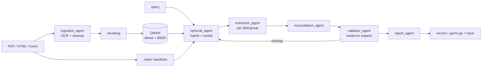

[](https://github.com/AnkitUzumaki/rfp-intel/actions/workflows/ci.yml)
[](LICENSE)

# RFP Intelligence Platform

Search, question-answering and structured extraction over RFP / bid document sets.
Hybrid retrieval (dense + BM25 + cross-encoder rerank) feeds a LangGraph multi-agent
pipeline that fills a typed record per bid, validates every field against cited evidence,
and produces a go / no-go recommendation.

Built for procurement documents that arrive as PDFs, scanned pages, HTML portals and
addenda — the messy real shape of a public-sector bid package.

## What it does

| Mode | Output |
|---|---|
| `search` | ranked, cited passages with page numbers and an abstain path |
| `ask` | cited answer from a QA agent over the indexed corpus |
| `extract` | typed bid record (`outputs/<bid>.json` + `.md`) plus a trace |
| `compare` | side-by-side field comparison of two or more bids |
| `go-no-go` | recommendation against a configurable company profile |
| `eval` | retrieval metrics (recall@k, MRR, nDCG) against a gold set |
| `serve` | FastAPI service on `:8000` |
| `ui` | Streamlit UI talking to the API |

## Architecture



Agents are LangGraph nodes in `agents/graph.py`. The graph parallelises field groups via
`Send`, loops back through retrieval when validation fails, and caps retries so a bad
document cannot spin.

## Quickstart

```bash
uv sync
cp .env.example .env          # then set the two LLM keys
uv run python main.py index data/Bid1 data/Bid2
uv run python main.py search "warranty requirements" --bid Bid1
uv run python main.py ask "What is the submission deadline?"
uv run python main.py extract data/Bid1
```

Or with `make`:

```bash
make setup      # uv sync + .env from template
make test       # pytest with coverage
make eval       # retrieval metrics -> eval/report.md
make extract    # both sample bids -> outputs/
make docker     # API + Qdrant via docker compose
```

## Configuration

Non-secret settings live in `config/settings.yaml`. Secrets and model names come from the
environment (`.env` in development, real env vars in deployment).

| Variable | Required | Purpose |
|---|---|---|
| `LLM_BASE_URL` | yes | OpenAI-compatible endpoint |
| `LLM_MODEL` | yes | primary model id |
| `LLM_API_KEY` | yes | primary provider key |
| `LLM_SMALL_MODEL` | no | cheaper model for query expansion and the judge |
| `FALLBACK_BASE_URL` / `FALLBACK_MODEL` / `FALLBACK_API_KEY` | no | provider used on timeout or 429 |
| `QDRANT_URL` | no | use a Qdrant server instead of embedded mode |
| `RFP_SETTINGS` | no | alternate path to `settings.yaml` |

## Retrieval results

Gold set: 27 questions, page-level relevance, filtered by bid.

| config | recall@1 | recall@5 | recall@10 | MRR | nDCG@10 | p50 ms |
|---|---|---|---|---|---|---|
| vector-only | 0.704 | 0.926 | 0.926 | 0.804 | 0.787 | 11 |
| bm25-only | 0.778 | 0.963 | 1.000 | 0.865 | 0.877 | 17 |
| hybrid | 0.778 | 0.963 | 0.963 | 0.864 | 0.854 | 17 |
| hybrid+rerank | 0.852 | 0.963 | 1.000 | 0.900 | 0.888 | 4123 |

`hybrid+rerank` is the default. Rerank costs latency, so `search --no-rerank` keeps the
cheap path available. Full table: `eval/report.md`.

## API

| Method | Route | Purpose |
|---|---|---|
| GET | `/health` | liveness |
| GET | `/bids` | indexed bids |
| POST | `/index` | index bid folders |
| GET | `/search` | retrieval with citations |
| POST | `/ask` | cited answer |
| POST | `/extract` | run the extraction pipeline |
| GET | `/bids/{bid_id}/record` | stored record |
| POST | `/compare` | multi-bid comparison |
| POST | `/go-no-go` | recommendation |

Docs at `/docs` once `main.py serve` is running.

## Project layout

```
agents/      LangGraph nodes: ingestion, retrieval, extraction, reconciliation, validator, report, qa
api/         FastAPI service
config/      settings, field schema, synonyms, company profile
eval/        gold sets, retrieval evaluation, extraction scoring, CI gate
ingestion/   PDF/HTML parsing, OCR, chunking
search/      Qdrant store, hybrid retrieval, reranking, semantic cache
ui/          Streamlit client
tests/       60 tests, fake LLM, no API key needed
data/        sample bid packages (Bid1, Bid2)
```

## Tests and CI

```bash
uv run pytest -q
uv run ruff check .
uv run mypy ingestion search agents api settings.py
```

CI runs lint, types, tests, the retrieval gate, and a Docker build on every push.
Tests use a scripted fake LLM, so no key is required.

## Design notes

`PLAN.md` records the build plan, requirement-to-code mapping and each objective check.
The validation loop, evidence guardrail and confidence weights are documented there.

## License

MIT — see [LICENSE](LICENSE).
